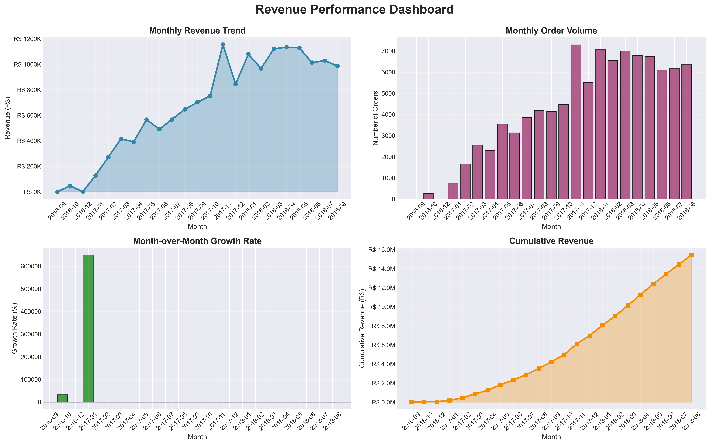
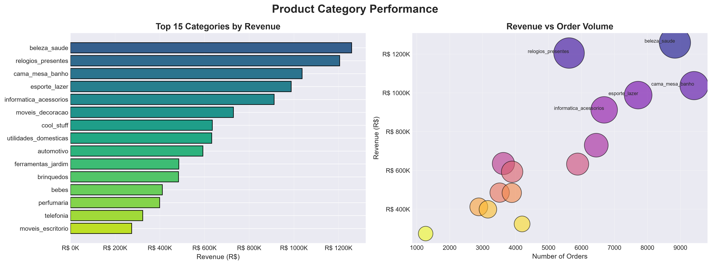
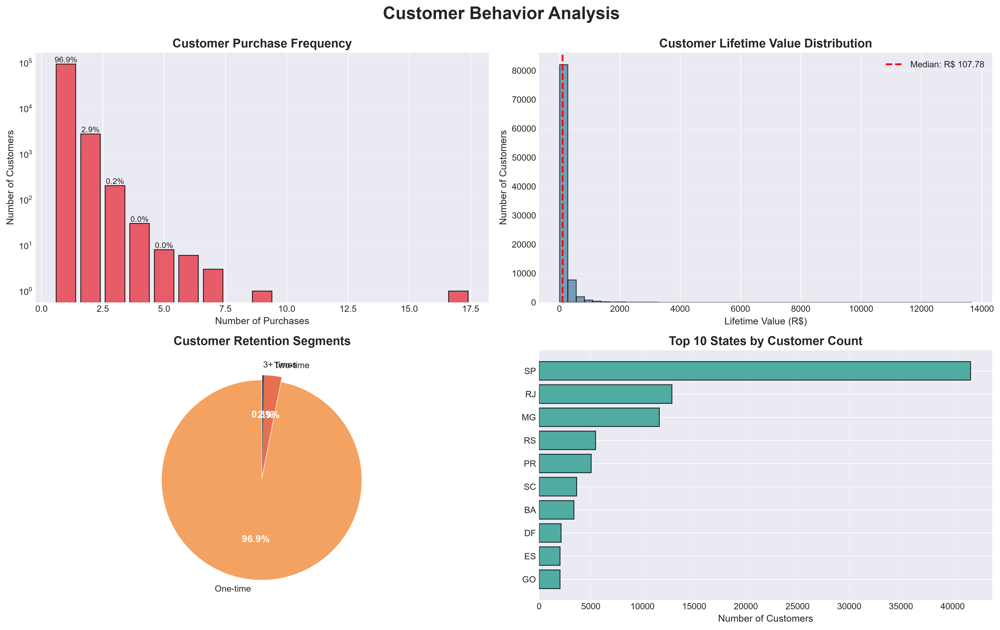
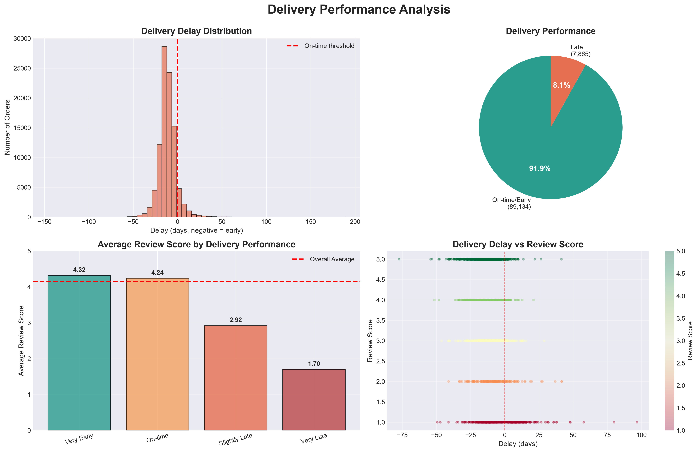
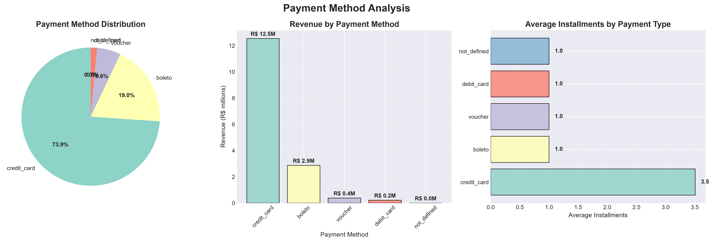
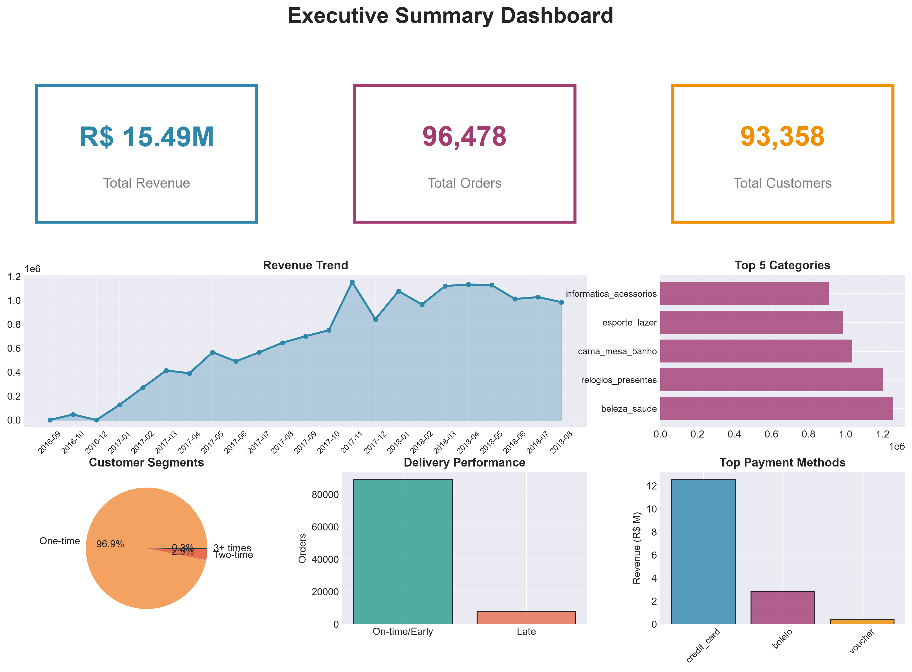
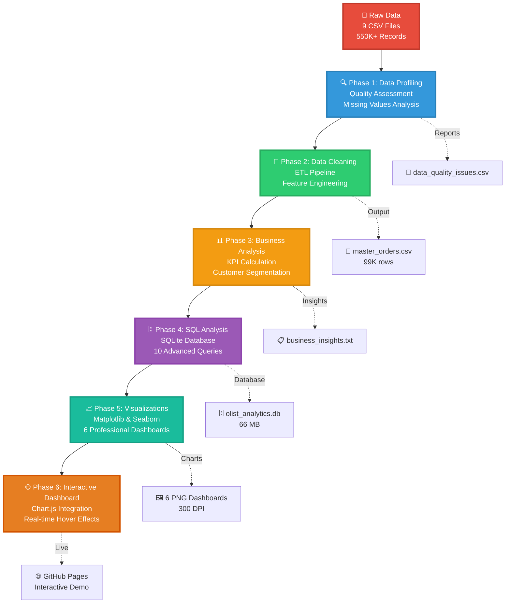
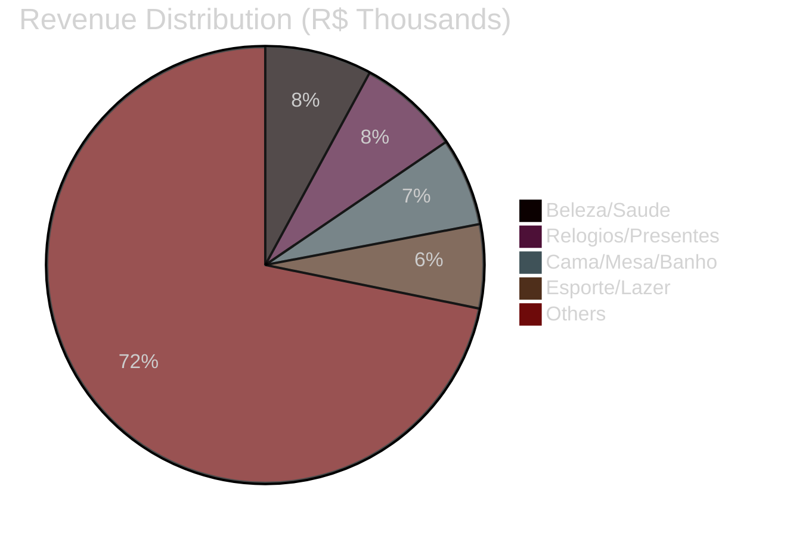
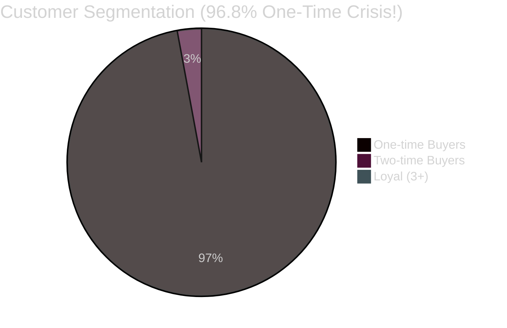
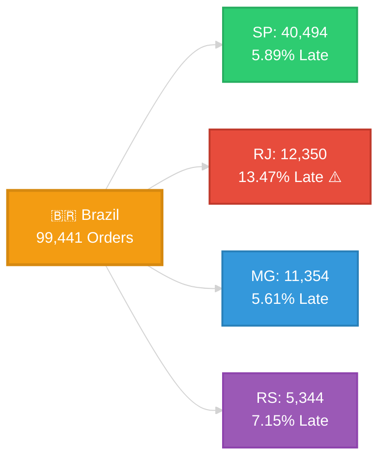

<div align="center">

# 🛍️ Olist E-Commerce Analytics

### End-to-End Data Analytics Pipeline

[](https://www.python.org/)
[](https://pandas.pydata.org/)
[](https://www.sqlite.org/)
[](https://www.chartjs.org/)

[](https://github.com/Ajinkya-Ghuge/Olist-E-Commerce-Marketplace-analysis)
[](LICENSE)
[](https://github.com/Ajinkya-Ghuge/Olist-E-Commerce-Marketplace-analysis/pulls)
[](https://github.com/Ajinkya-Ghuge/Olist-E-Commerce-Marketplace-analysis/stargazers)
[](https://github.com/Ajinkya-Ghuge/Olist-E-Commerce-Marketplace-analysis/network/members)

---

### 🎯 [View Live Interactive Dashboard](https://ajinkya-ghuge.github.io/Olist-E-Commerce-Marketplace-analysis/interactive_dashboard.html) | 📊 [Explore Analysis](https://github.com/Ajinkya-Ghuge/Olist-E-Commerce-Marketplace-analysis/tree/main/analysis) | 📖 [Read Full Documentation](INTERVIEW_EXPLANATION.md)

---

<p align="center">
  
  
  
  
</p>

<p align="center">
  
  
  
  
  
</p>

</div>

---

## 🚀 Project Overview

A **comprehensive data analytics portfolio project** that demonstrates the complete analytics lifecycle: from raw data profiling to interactive dashboard delivery. Analyzed **R$ 15.9M** in Brazilian e-commerce transactions to uncover critical business insights.

### ✨ Key Highlights

```
📊 Analyzed 99,441 orders across 23 months
💰 Total Revenue: R$ 15.9M (Brazilian marketplace)
🎯 Discovered 96.8% one-time buyer crisis
📈 Built 6 professional dashboards with 20+ visualizations
🔍 Wrote 10 advanced SQL queries (CTEs, Window Functions, Joins)
🌐 Created fully interactive web dashboard with Chart.js
```

---

## 📋 Table of Contents

- [🚀 Project Overview](#-project-overview)
- [🎬 Live Demo](#-live-demo)
- [🔥 Key Findings](#-key-findings)
- [🛠️ Tech Stack](#️-tech-stack)
- [⚡ Quick Start](#-quick-start)
- [📊 Visualizations](#-visualizations)
- [📁 Project Structure](#-project-structure)
- [💡 Analysis Workflow](#-analysis-workflow)
- [📈 Business Impact](#-business-impact)
- [🎓 Skills Demonstrated](#-skills-demonstrated)
- [📝 License](#-license)
- [🤝 Contributing](#-contributing)
- [📧 Contact](#-contact)

---

## 🎬 Live Demo

<div align="center">

### 🌐 [**Click Here to View Interactive Dashboard**](https://ajinkya-ghuge.github.io/Olist-E-Commerce-Marketplace-analysis/)


**Features:**
- 🖱️ Hover over any data point to see exact values
- 📊 5 interactive chart types (Line, Bar, Doughnut, Pie, Multi-axis)
- 🎨 Professional dark theme with smooth animations
- 📱 Works on desktop, tablet, and mobile

</div>

> **Note:** The dashboard uses Chart.js for real-time interactivity. All data is pre-aggregated from the SQL analysis.

---

## 🔥 Key Findings

<table>
<tr>
<td width="33%" align="center">

### 🚨 Customer Retention Crisis

**96.8%** of customers buy **only once**

Only **3.2%** return for second purchase

**💡 Impact:** Millions in untapped revenue

</td>
<td width="33%" align="center">

### ⏰ Delivery Quality Matters

Late deliveries score **2.27** ⭐  
On-time deliveries score **4.29** ⭐

**-2.02 point** satisfaction drop

Only **6.8%** late but huge damage

</td>
<td width="33%" align="center">

### 📦 Category Winners

Top 3 categories = **R$ 3.4M** (21%)

**#1:** Beleza/Saude (R$ 1.26M)

**#2:** Relogios/Presentes (R$ 1.21M)

Peak: **Nov 2017** (R$ 1.15M)

</td>
</tr>
</table>

---

## 🛠️ Tech Stack

<div align="center">

### Languages & Libraries


### Database & Query


### Web & Visualization


### Tools


</div>

---

## ⚡ Quick Start

### Option 1: View Interactive Dashboard (Recommended! 🌟)

```bash
# Just open in your browser:
https://ajinkya-ghuge.github.io/Olist-E-Commerce-Marketplace-analysis/

# OR download and open locally:
git clone https://github.com/Ajinkya-Ghuge/Olist-E-Commerce-Marketplace-analysis.git
cd Olist-E-Commerce-Marketplace-analysis
# Double-click: interactive_dashboard.html
```

### Option 2: Run the Full Python Pipeline

```bash
# 1. Clone the repository
git clone https://github.com/Ajinkya-Ghuge/Olist-E-Commerce-Marketplace-analysis.git
cd Olist-E-Commerce-Marketplace-analysis

# 2. Install dependencies
pip install pandas numpy matplotlib seaborn

# 3. Run analysis scripts (in order)
python analysis/01_simple_data_profiling.py
python analysis/02_simple_data_cleaning.py
python analysis/03_simple_business_analysis.py
python analysis/04_sql_analysis.py
python analysis/05_visualizations.py

# 4. View results
# Open: interactive_dashboard.html in browser
# OR check: reports/charts/ for PNG dashboards
```

### Option 3: One-Click Run (Windows)

```bash
# Just run this:
run_all.bat
```

---

## 📊 Visualizations

<div align="center">

### 🎨 Dashboard Gallery

<table>
<tr>
<td width="50%">

#### 📈 Revenue Performance Dashboard

*Monthly trends, growth rates, and cumulative revenue*

</td>
<td width="50%">

#### 📦 Category Analysis

*Top 15 categories and revenue vs volume analysis*

</td>
</tr>
<tr>
<td width="50%">

#### 👥 Customer Behavior

*Purchase frequency, segmentation, and geography*

</td>
<td width="50%">

#### 🚚 Delivery Performance

*Delay analysis and satisfaction correlation*

</td>
</tr>
<tr>
<td width="50%">

#### 💳 Payment Analysis

*Methods, revenue distribution, installments*

</td>
<td width="50%">

#### 📊 Executive Dashboard

*All key metrics in one comprehensive view*

</td>
</tr>
</table>

### 🌐 Interactive Features Demo

<p align="center">
  
  
  
</p>

</div>

> **💡 Pro Tip:** Click any chart above to see full resolution. Visit the [Live Interactive Dashboard](https://ajinkya-ghuge.github.io/Olist-E-Commerce-Marketplace-analysis/interactive_dashboard.html) to hover over data points for real-time insights!

---

## 📁 Project Structure

```plaintext
Olist-E-Commerce-Marketplace-analysis/
│
├── 📊 interactive_dashboard.html       # ⭐ Interactive web dashboard (Chart.js)
├── 📄 README.md                        # You are here!
├── 📋 INTERVIEW_EXPLANATION.md         # Complete project walkthrough
├── 📝 PLAN.md                          # Project roadmap
│
├── 🐍 analysis/                        # Python analysis scripts
│   ├── 01_simple_data_profiling.py    # Data quality assessment
│   ├── 02_simple_data_cleaning.py      # ETL pipeline
│   ├── 03_simple_business_analysis.py  # KPI calculations
│   ├── 04_sql_analysis.py              # 10 advanced SQL queries
│   └── 05_visualizations.py            # Professional charts
│
├── 💾 data/
│   ├── processed/                      # Cleaned datasets
│   │   └── master_orders.csv          # Combined dataset (99K rows)
│   └── olist_analytics.db             # SQLite database (66 MB)
│
├── 📁 dataset/                         # Original 9 CSV files
│   ├── olist_orders_dataset.csv
│   ├── olist_order_items_dataset.csv
│   └── ... (7 more files)
│
├── 📊 reports/
│   ├── charts/                         # 6 professional PNG dashboards
│   │   ├── 01_revenue_dashboard.png
│   │   ├── 02_category_analysis.png
│   │   └── ... (4 more dashboards)
│   │
│   ├── 📈 sql_*.csv                    # SQL query results (10 files)
│   ├── 📄 business_insights.txt        # Executive summary
│   └── 📊 summary_metrics.csv          # All KPIs
│
├── 📚 docs/
│   └── data_dictionary.md              # Complete schema documentation
│
└── ⚙️ powerbi/
    └── POWERBI_GUIDE.md                # Power BI tutorial
```

---

## 💡 Analysis Workflow



### Phase-by-Phase Breakdown

| Phase | Script | What It Does | Output |
|-------|--------|--------------|--------|
| **1. Profiling** | `01_simple_data_profiling.py` | Quality assessment, missing values, duplicates | `data_quality_issues.csv` |
| **2. Cleaning** | `02_simple_data_cleaning.py` | Data transformation, feature engineering | `master_orders.csv` (99K rows) |
| **3. Business** | `03_simple_business_analysis.py` | KPI calculation, segmentation | `business_insights.txt` |
| **4. SQL** | `04_sql_analysis.py` | 10 advanced queries, database creation | `olist_analytics.db` (66 MB) |
| **5. Visualization** | `05_visualizations.py` | 20+ professional charts | 6 PNG dashboards |
| **6. Dashboard** | `interactive_dashboard.html` | Interactive web interface | Chart.js dashboard |

---

## 📊 Visual Data Insights

<div align="center">

### 📈 Revenue by Top Categories



### 🔄 Customer Purchase Behavior



### 🚚 Delivery Performance by Top States



</div>

### 📊 Key Metrics Progress

<table width="100%">
<tr><td>

**💰 Revenue Achievement**  


**⭐ Customer Satisfaction**  
&width=500&color=2ecc71)

**🔄 Repeat Customer Rate** ⚠️  


**📦 On-Time Delivery**  


**💳 Payment Reconciliation**  


</td></tr>
</table>

### 📈 Monthly Revenue Trend (ASCII Chart)

```
R$ (Thousands)
1200 |                    ●●●
1000 |               ●●●  ││││  ●●●●●
 800 |           ●●●││││││││││││││││││
 600 |       ●●●││││││││││││││││││││││
 400 |   ●●●││││││││││││││││││││││││││
 200 | ●●││││││││││││││││││││││││││││││
   0 |─┴┴┴┴┴┴┴┴┴┴┴┴┴┴┴┴┴┴┴┴┴┴┴┴┴┴┴┴┴┴┴
     Sep'16    2017 Timeline    Aug'18
     
● Peak: Nov 2017 (R$ 1,153K - Black Friday Effect!)
```

---

## 📈 Business Impact

### 💰 Revenue Opportunities

| Initiative | Current | Target | Potential Impact |
|------------|---------|--------|------------------|
| **Retention Rate** | 3.2% | 6.0% | **+R$ 461K** additional revenue |
| **Late Deliveries** | 6.8% | 3.0% | **+0.15 points** avg rating increase |
| **Category Focus** | Diversified | Top 3 focus | **+R$ 1M+** from inventory optimization |

### 🎯 Recommended Actions

1. **Launch Loyalty Program**
   - Target: 93,099 one-time buyers
   - Goal: Double repeat rate to 6%
   - Tactics: Email campaigns, exclusive offers, points system

2. **Fix Delivery Performance**
   - Focus on 6.8% late deliveries (6,562 orders)
   - Improve logistics in RJ (13.47% late) and BA (14.04% late)
   - Goal: Reduce late deliveries to 3%

3. **Expand Winning Categories**
   - Double inventory in Beleza/Saude, Relogios/Presentes
   - Marketing spend optimization
   - Goal: Increase top 3 category revenue by 30%

---

## 🎓 Skills Demonstrated

<div align="center">

| Category | Skills |
|----------|--------|
| **Data Engineering** | ETL Pipeline, Data Quality Checks, Schema Design, Data Validation |
| **Python** | Pandas, NumPy, Matplotlib, Seaborn, Data Manipulation |
| **SQL** | JOINs, CTEs, Window Functions, Aggregations, Date Functions |
| **Statistics** | Correlation Analysis, Segmentation, Distribution Analysis |
| **Visualization** | Chart Selection, Color Theory, Visual Hierarchy, Storytelling |
| **Web Development** | HTML5, CSS3, JavaScript, Chart.js, Responsive Design |
| **Business Analysis** | KPI Definition, Insight Generation, Recommendation Creation |
| **Documentation** | Technical Writing, Data Dictionaries, Process Documentation |

</div>

---

## 📝 Dataset

**Source:** [Olist Brazilian E-Commerce Dataset](https://www.kaggle.com/datasets/olistbr/brazilian-ecommerce)  
**Period:** September 2016 – August 2018  
**Records:** 99,441 orders | 112,650 order items | 99,224 reviews

### Tables Included:
- 📦 Orders (order status, timestamps)
- 📋 Order Items (products, prices, freight)
- 💳 Payments (payment methods, installments)
- ⭐ Reviews (scores, comments)
- 👥 Customers (demographics, location)
- 🏪 Sellers (seller information)
- 📦 Products (categories, dimensions)
- 🌍 Geolocation (lat/long coordinates)
- 🔤 Category Translation (Portuguese → English)

---

## 📝 License

This project is licensed under the MIT License - see the [LICENSE](LICENSE) file for details.

---

## 🤝 Contributing

Contributions are welcome! Feel free to:

- 🐛 Report bugs
- 💡 Suggest new features
- 📝 Improve documentation
- 🔧 Submit pull requests

```bash
# Fork the repository
# Create your feature branch
git checkout -b feature/AmazingFeature

# Commit your changes
git commit -m 'Add some AmazingFeature'

# Push to the branch
git push origin feature/AmazingFeature

# Open a Pull Request
```

---

## 📧 Contact

**Ajinkya Ghuge**

[](https://www.linkedin.com/in/ajinkya-ghuge)
[](https://github.com/Ajinkya-Ghuge)
[](mailto:your.email@example.com)

---

<div align="center">

### ⭐ Star this repo if you found it helpful!

### 🚀 [View Live Dashboard](https://ajinkya-ghuge.github.io/Olist-E-Commerce-Marketplace-analysis/) | 📖 [Read Full Documentation](INTERVIEW_EXPLANATION.md)

**Made with ❤️ by [Ajinkya Ghuge](https://github.com/Ajinkya-Ghuge)**

</div>
