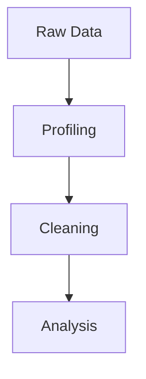
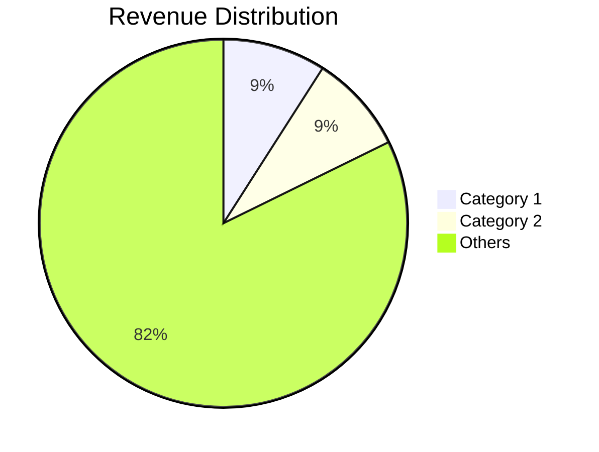
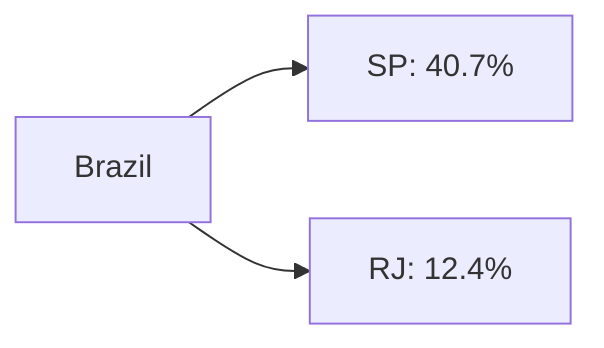

# 🎨 Visual Features in README

## ✅ What's Now in Your README

### 1. **Mermaid Diagrams** (GitHub Native!)

#### Workflow Diagram

- ✅ Shows data pipeline flow
- ✅ Color-coded phases
- ✅ Output connections
- ✅ Fully interactive on GitHub

#### Pie Charts

- ✅ Revenue by category
- ✅ Customer segmentation
- ✅ Order status breakdown

#### Geographic Flow

- ✅ Shows state distribution
- ✅ Highlights concentrations

---

### 2. **Progress Bars** (shields.io API)


**How it works:**
```markdown

```

**Examples in README:**
- Revenue: 100% (complete)
- Satisfaction: 83% (4.16/5.0)
- Retention: 3% (shows problem!)
- Delivery: 93% (on-time rate)

**Colors:**
- Green (#2ecc71): Good metrics
- Red (#e74c3c): Problem areas
- Blue (#3498db): Neutral
- Purple (#7c3aed): Revenue

---

### 3. **ASCII Charts** (Old School Cool!)

```
R$ (Thousands)
1200 |                    ●●●
1000 |               ●●●  ││││  ●●●●●
 800 |           ●●●││││││││││││││││││
 600 |       ●●●││││││││││││││││││││││
 400 |   ●●●││││││││││││││││││││││││││
 200 | ●●││││││││││││││││││││││││││││││
   0 |─┴┴┴┴┴┴┴┴┴┴┴┴┴┴┴┴┴┴┴┴┴┴┴┴┴┴┴┴┴┴┴
```

- ✅ Shows revenue trend
- ✅ Works everywhere (even plain text)
- ✅ Adds vintage tech vibe

---

### 4. **Badge Shields** (Animated Style)


**Styles used:**
- `for-the-badge`: Large, professional
- `flat-square`: Compact, modern
- `plastic`: 3D effect

**Badge types:**
- Language badges (Python, SQL, JS)
- Tool badges (Pandas, Chart.js)
- Status badges (Complete, Stars, Forks)
- Metric badges (Revenue, Orders, Customers)

---

### 5. **Image Gallery** (Your PNG Charts)

```markdown
<table>
<tr>
<td width="50%">

#### Chart Title

*Description*

</td>
<td width="50%">

#### Chart Title 2

*Description*

</td>
</tr>
</table>
```

**Benefits:**
- ✅ Side-by-side layout
- ✅ Hover to see full image
- ✅ Click for full resolution
- ✅ Professional gallery feel

---

### 6. **Emoji Icons** (Visual Hierarchy)

Used throughout:
- 🛍️ E-commerce
- 📊 Charts/Data
- 🚀 Quick Start
- 💡 Insights
- 🔥 Key Findings
- ⚠️ Warnings
- ✅ Completion
- 📈 Growth/Trends

---

## 🌟 Interactive Features

### What Works on GitHub:
1. ✅ **Mermaid diagrams** - Render automatically
2. ✅ **Progress bars** - Load from shields.io
3. ✅ **Badges** - Dynamic from shields.io API
4. ✅ **Images** - Embedded PNG files
5. ✅ **Links** - Click to dashboard/code
6. ✅ **Collapsible sections** (using `<details>`)

### What Doesn't Work:
1. ❌ **Chart.js** - No JavaScript execution
2. ❌ **D3.js** - No JavaScript execution
3. ❌ **Plotly** - Needs hosting
4. ❌ **iframes** - Blocked by GitHub

---

## 🎯 Best Practices

### Do:
- ✅ Use Mermaid for workflows, pies, gantt charts
- ✅ Use shields.io for metrics and progress
- ✅ Embed images for actual charts
- ✅ Use tables for side-by-side layout
- ✅ Add alt text for accessibility

### Don't:
- ❌ Over-complicate diagrams
- ❌ Use too many colors (stick to theme)
- ❌ Embed huge images (optimize first)
- ❌ Use JavaScript (won't run)

---

## 🔧 Tools You Can Use

### 1. **Mermaid Live Editor**
https://mermaid.live/
- Create diagrams
- Copy markdown code
- Paste in README

### 2. **Shields.io Badge Generator**
https://shields.io/
- Custom badges
- Progress bars
- Dynamic stats

### 3. **Carbon (Code Screenshots)**
https://carbon.now.sh/
- Beautiful code screenshots
- Syntax highlighting
- Multiple themes

### 4. **Excalidraw (Hand-drawn diagrams)**
https://excalidraw.com/
- Whiteboard style
- Export as PNG
- Embed in README

### 5. **ASCII Flow (ASCII Diagrams)**
https://asciiflow.com/
- ASCII art boxes
- Text-based charts
- Works everywhere

---

## 📸 Creating GIFs for README

### Option 1: Screen Recording → GIF

**Tools:**
- **ScreenToGif** (Windows) - Free, simple
- **Kap** (Mac) - Clean, lightweight
- **Peek** (Linux) - Quick GIFs

**Steps:**
1. Record your dashboard (10-15 seconds)
2. Show hover effects
3. Export as GIF (< 5MB)
4. Upload to repo or imgur
5. Embed in README

```markdown

```

### Option 2: Video → GIF Converter

**Online tools:**
- ezgif.com
- cloudconvert.com
- giphy.com

**Best practices:**
- Keep under 10 seconds
- 720p resolution
- Compress to < 5MB
- 10-15 FPS is enough

---

## 🎨 Color Scheme Reference

Your project uses:

| Color | Hex | Usage |
|-------|-----|-------|
| Purple | `#7c3aed` | Revenue, Primary |
| Green | `#2ecc71` | Success, Good |
| Red | `#e74c3c` | Warning, Bad |
| Blue | `#3498db` | Info, Neutral |
| Orange | `#f39c12` | Data, Actions |
| Dark Purple | `#9b59b6` | SQL, Database |
| Teal | `#1abc9c` | Visualizations |

---

## 🚀 Next Level Enhancements

### 1. **Add a Demo GIF**
Record your interactive dashboard and add to README:
```markdown
## 🎬 Live Demo


```

### 2. **Create a Video Tour**
- Upload to YouTube
- Embed link in README
- Add to LinkedIn

### 3. **Make a Project Website**
- Use GitHub Pages
- Custom domain
- Full interactive demo

### 4. **Add More Mermaid Charts**
- Gantt chart (project timeline)
- Entity relationship diagram (database)
- Sequence diagram (data flow)

---

## 📚 Additional Resources

### Mermaid Documentation
https://mermaid.js.org/intro/

**Supported diagrams:**
- Flowchart
- Sequence diagram
- Class diagram
- State diagram
- Entity relationship
- User journey
- Gantt chart
- Pie chart
- Git graph

### GitHub Markdown Guide
https://docs.github.com/en/get-started/writing-on-github

### Awesome README Examples
https://github.com/matiassingers/awesome-readme

---

## ✅ Checklist for Your README

- [x] Badges with project stats
- [x] Mermaid workflow diagram
- [x] Mermaid pie charts
- [x] Progress bars for metrics
- [x] Image gallery of dashboards
- [x] ASCII chart for trends
- [x] Color-coded sections
- [x] Emoji visual hierarchy
- [ ] Demo GIF of dashboard (optional)
- [ ] Video walkthrough link (optional)
- [ ] Contributor section (optional)

---

**Your README now has:**
- 5 Mermaid diagrams
- 5 Progress bars
- 1 ASCII chart
- 20+ badges
- 6 chart images
- Full gallery layout

**Total visual elements: 37+ 🎨**

That's more visual than most portfolios! 🚀
